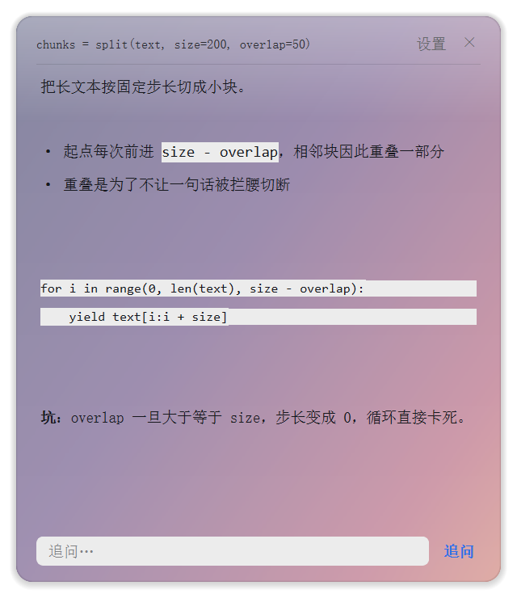

# Ask AI Popup

**选中一段文字，按一个快捷键，旁边弹出小窗把它讲透 —— 而且知道这段话出自哪。**
Select text anywhere → one hotkey → a floating window explains *that piece*, with the surrounding context already loaded.



---

## 它解决的是什么问题

你让 AI 给你讲一个概念，它回了一整套分步教程。
你看到第 4 步的代码里有个函数不懂，于是把这个函数复制出去问另一个窗口 ——
结果它不知道你说的是哪一步，从零开始又讲一遍。

这个工具做的是**按位置取上下文**：

1. 抓到你选中的那段文字
2. 回到 Claude Code 最近的会话记录里，定位这段文字**出自哪一条 AI 回复**
3. 把那条回复连同**前后各一条**一起塞进 prompt

所以它回答的是「这一段在你的整套讲解里是什么位置」，而不是重新讲一遍。

定位不到就退回「最近两条回复」，不会因为找不到就罢工。

---

## 跟别的划词工具差在哪

| | 普通划词翻译 / 问 AI | 这个 |
|---|---|---|
| 发出去的内容 | 只有你选中的那几十个字 | 选中的字 + 它所在的整段讲解 + 前后文 |
| 回答的视角 | 孤立解释 | 知道你正学到第几步 |
| 追问 | 大多要重新选一次 | 窗口里有输入框，接着聊 |
| 外观 | 固定样式 | 背景图、配色、字体、字号、行距全可调 |

---

## 安装

```bash
pip install -r requirements.txt
```

需要 Python 3.9+，Windows（用到了 Win32 热键 API，Linux/macOS 跑不起来）。

## 配置 API key

三种方式，任选一种：

```bash
# 1. 环境变量
set ASK_AI_API_KEY=sk-xxxx

# 2. 装过 Claude Code 的话，它直接读 ~/.claude/settings.json 里的 ANTHROPIC_AUTH_TOKEN
# 3. 换服务商
set ASK_AI_BASE_URL=https://api.openai.com/v1
set ASK_AI_MODEL=gpt-4o-mini
```

## 运行

```bash
python ask_ai.py            # 启动
python ask_ai.py --test     # 自检：key、剪贴板、模型连通性
```

| 快捷键 | 作用 |
|---|---|
| `Ctrl+Alt+Space` | 解释选中的文字 |
| `Ctrl+Alt+Shift+S` | 设置 |
| `Ctrl+Alt+Shift+X` | 退出 |

窗口无边框，按住空白处可以拖，`Esc` 或右上角 `×` 关闭。

## 设置里能改什么

- **配色**：四套预设（浅色 / 深色 / 米黄 / 护眼绿）+ 自定义背景色、文字色、强调色
- **背景**：任意图片铺底，配「压暗程度」和「模糊」两个滑块控制图片和文字的比重
- **字体**：宋体 / 黑体 / 雅黑，字号 7–28
- **上下文**：往回翻多少条回复、每条截多少字、带多少条你的提问
- **提示词**：整段 system prompt 可改

设置存在脚本同目录的 `ask_ai_config.json`，不进版本库。

---

## 几个实现上值得说的坑

**1. 不能用全局键盘钩子。**
一开始用 `keyboard` 库，它装的是全局钩子，系统里每个按键都要过一遍 Python 回调 —— 打字明显变卡。换成 Win32 原生 `RegisterHotKey`，零开销。

**2. `RegisterHotKey` 的消息只投递给注册它的那个线程。**
所以注册和 `GetMessageW` 必须在同一个线程里完成。放在主线程（跑 GUI 事件循环）注册，再靠定时器轮询，是收不到 `WM_HOTKEY` 的。

**3. 热键触发时，物理按键还按着。**
这时模拟 `Ctrl+C` 去复制，目标程序收到的是 `Ctrl+Alt+C`，不是复制 —— 表现就是「明明选中了却读不到」。所以要先轮询 `GetAsyncKeyState` 等到所有修饰键松开。

**4. 无边框窗口的背景得自己画。**
`paintEvent` 里按顺序来：圆角裁切 → 画背景图 → 叠渐变遮罩 → 外圈叠九层淡黑做投影 → 最后描一道 1px 内边线。中间一层还得单独给顶部加暗，否则壁纸一花，标题和按钮就看不清了。

**5. 超大图 Qt 读不动。**
1 亿像素的壁纸直接 `QPixmap(path)` 会撞上 Qt 的内存上限，静默返回 0×0 —— 表现是「背景图设了但不显示」。改成先按目标尺寸解码，再不行用 Pillow 缩。

**6. 窗口可能在流式过程中被销毁。**
连按两次热键时旧窗口会被 `deleteLater()`，但它的流式线程还在跑，往死掉的接收者发信号会抛 `RuntimeError`。信号发送统一过一层守卫。

---

## 已知限制

- 只支持 Windows
- 会话上下文只认 Claude Code 的记录（`~/.claude/projects/*.jsonl`），其他工具的记录读不到，会退回无上下文模式
- 抓选区时会临时清空剪贴板
- Markdown 只处理代码块、粗体、行内代码、标题、列表，表格不渲染

## License

MIT
